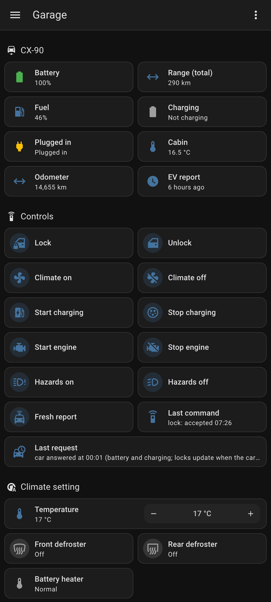
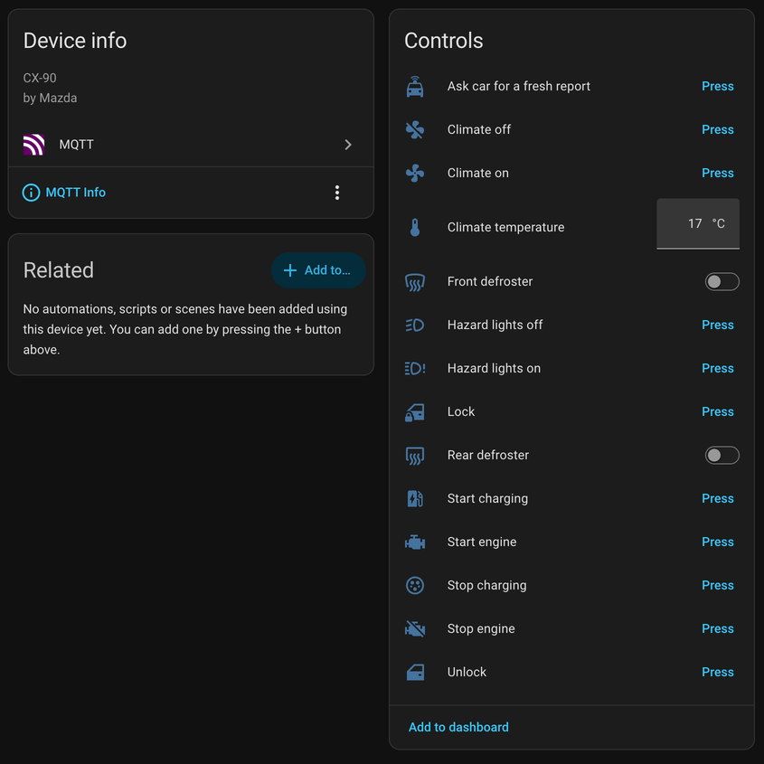

# mcs

[](https://github.com/cv/mcs/releases/latest)
[](https://github.com/cv/mcs/actions/workflows/ci.yml)
[](LICENSE)

**Your Mazda from the terminal, and in Home Assistant.** `mcs` is an unofficial
client for Mazda Connected Services (MyMazda): check the battery, lock the
doors or warm up the cabin with one command. `mcs mqtt` puts the car on MQTT,
and Home Assistant then finds it with its readings and controls ready to use.

<p align="center">
  
  &nbsp;
  
</p>
<p align="center"><sub>A CX-90 PHEV in Home Assistant: a dashboard built from the entities (left) and the device <code>mcs mqtt</code> creates (right).</sub></p>

## Features

- **Status at a glance**: battery, charging, range, fuel, odometer, tire
  pressures, doors, locks, windows, hazards, cabin temperature, location.
- **Remote control**: lock and unlock, engine start and stop, charging, climate
  (with temperature and defrosters), hazard lights, a fresh report from the car.
- **Health report**: oil change due, maintenance, oil level, tire pressure and
  bulb warnings.
- **Home Assistant, without an integration to install**: up to 67 entities
  through MQTT discovery, plus a `device_tracker` for home / not home if you want one.
- **Careful with your session**: reuses and refreshes one cached session, so a
  server doesn't need your password and won't sign your phone out.
- **Private by default**: what it publishes is an allowlist (no VIN, coordinates or
  ids), and logs carry result codes, never tokens.
- **Small**: one static binary; `mcs mqtt` uses about 7 MB of memory.
- **Agent-ready**: a skill so coding agents can "warm up the car" for you.

## Install

```bash
brew install cv/taps/mcs                      # macOS and Linux
go install github.com/cv/mcs/cmd/mcs@latest   # with Go 1.27+
```

Or download a binary for macOS, Linux or Windows from the
[releases](https://github.com/cv/mcs/releases/latest), or build the container
image: `docker build -t mcs .`

## Sign in

Create `~/.config/mcs/config.toml`:

```toml
email = "you@example.com"
password = "your MyMazda password"
region = "MNAO"   # MNAO North America, MME Europe, MJO Japan
country = "US"    # the account's country; defaults: US, GB, JP
```

(or set `MCS_EMAIL`, `MCS_PASSWORD`, `MCS_REGION`, `MCS_COUNTRY`), then run
`mcs status`. The first command signs in and saves the session in
`~/.cache/mcs/token.json`; later ones reuse and refresh it.

> **One session at a time.** Signing in can sign the MyMazda app out on your
> phone, so mcs signs in only when it has no session, and never in a loop.
> Sign in again in the app if it asks; to sign mcs in again, delete the cache.

## Command line

```bash
mcs status              # everything, with how old each report is
mcs status --json       # the same, as JSON
mcs status --refresh    # ask the car for a fresh report first (EV and PHEV)

mcs lock | unlock       # doors
mcs start | stop        # remote engine start
mcs charge start|stop   # charging
mcs climate on|off      # climate
mcs climate set --temp 21   # temperature (°C)
mcs lights on|off       # hazard lights, to find the car

mcs raw status|ev|health|hvac   # the API's raw JSON
mcs completion bash     # also zsh, fish, powershell
```

```
$ mcs status
CX-90 PHEV 2.5L (2025)
VIN: JM3KKDHA*********

Status as of 2025-12-19 09:17:02 (5 min ago)

BATTERY: 43%
FUEL: 92% (10 km EV + 610 km fuel = 620 km total)
CLIMATE: Off
DOORS: All locked
WINDOWS: All closed
TIRES: FL:32.0 FR:32.0 RL:32.0 RR:32.0 PSI
ODOMETER: 5,279.4 km
```

Tire pressures are coloured by how far they are from 36 psi: green within 3,
yellow 4 to 6, red beyond.

## Home Assistant

`mcs mqtt` polls the car every 5 minutes and publishes it to an MQTT broker,
with Home Assistant discovery. Home Assistant creates a device with sensors,
binary sensors, buttons, a number, switches and a device tracker; nothing to
install in Home Assistant besides its MQTT integration.

### Setup

1. **A broker.** If you don't have one, install Home Assistant's *Mosquitto
   broker* add-on (or run [Mosquitto](https://mosquitto.org) anywhere) and give
   `mcs` its own login. Make sure Home Assistant's MQTT integration is set up.

2. **Sign in once** on your computer (see [Sign in](#sign-in)), with `mcs status`.

3. **Try it**, without sending anything:

   ```bash
   mcs mqtt --prefix mazda/my_car --once --dry-run
   ```

   It polls once and prints every topic and payload it would publish.

4. **Configure it.** Add an `[mqtt]` section to `~/.config/mcs/config.toml`
   ([full example](examples/mqtt/config.toml)):

   ```toml
   [mqtt]
   broker = "tcp://homeassistant.local:1883"
   username = "mcs"
   password_file = "/home/me/.config/mcs/mqtt.pw"   # or MCS_MQTT_PASSWORD
   prefix = "mazda/my_car"                       # required: the topic root
   controls = ["lock", "climate", "refresh"]    # leave out for read-only
   # home = "40.7128,-74.0060"                   # adds home / not_home presence
   ```

   Every setting is also an `MCS_MQTT_<KEY>` variable (`MCS_MQTT_PREFIX`, ...)
   and a flag (`--prefix`, ...). The prefix and the broker have no default.

5. **Run it** wherever it can stay up:
   - **Foreground**: `mcs mqtt`
   - **systemd**: [examples/mqtt/mcs-mqtt.service](examples/mqtt/mcs-mqtt.service)
   - **Docker Compose**: [examples/mqtt/compose.yaml](examples/mqtt/compose.yaml)

   On another machine, copy `~/.cache/mcs/token.json` (the session) and the
   config there, and remove the config's `password` line: `mcs mqtt` only
   refreshes the session and never signs in. Keep a single copy in use: the
   session's tokens rotate, so two copies would invalidate each other.

The car appears in Home Assistant as a device (*Settings → Devices & services
→ MQTT*), ready for dashboards and automations.

### What you get

| | Entities |
|---|---|
| EV report | battery, charging, plugged in, range, charge time left, battery heater, cabin temperature, climate and defrosters running |
| Vehicle report | fuel, odometer, four tire pressures |
| Doors report | locked (all and each door), each door and window, trunk, hood, fuel lid, hazards, presence |
| Health report | oil change in (km), maintenance in, oil low / overfilled, tire pressure low, tire sensor fault, bulb out |
| Controls (opt-in) | lock, unlock, start / stop engine, start / stop charging, climate on / off, hazards on / off, climate temperature, front / rear defroster, *ask car for a fresh report* |
| Diagnostics | cloud connection, last poll, last command, each report's time |

The car sends its reports separately, each when it was last used or asked, so
each value carries its report's time. Locks, doors, windows and presence turn
*unavailable* once their report is older than 30 minutes: an old "unlocked"
never looks current. The rest keep their last value.

### Controls and safety

- **Nothing moves the car unless you enable it.** `controls` lists the groups
  allowed: `lock`, `unlock`, `engine`, `charge`, `climate`, `lights`,
  `refresh`, or `all`. The others get no entities.
- Commands are live MQTT messages to `<prefix>/cmd/<name>/set`; retained ones
  never run, so a reconnect can't replay an unlock.
- Each command goes out at most once a minute (engine start once per 10 minutes,
  a fresh report once per 30), across restarts. The outcome shows as *Last
  command*. Mazda accepts the command and the car acts a few seconds later (the
  MyMazda app notifies you).
- Every command wakes the car's modem; Mazda allows two remote starts without
  driving.

### Reference

| Setting | Default | |
|---|---|---|
| `broker` | (required) | `tcp://host:1883`, `ssl://host:8883` |
| `prefix` | (required) | topic root, e.g. `mazda/my_car` |
| `username`, `password_file` | | the password can also come from `MCS_MQTT_PASSWORD` |
| `controls` | none | see above |
| `home`, `home_radius_m` | off, 200 | `LAT,LON` for home / not_home; coordinates are never published |
| `discovery` | `homeassistant` | discovery prefix, or `off` |
| `device_name` | `Mazda <model>` | |
| `poll`, `health`, `stale` | 5m, 30m, 30m | poll at least every 5m |
| `command_interval`, `engine_interval`, `refresh_interval` | 1m, 10m, 30m | |
| `state_dir` | `~/.local/state/mcs` | rate limits |
| `wait_on_auth_loss` | false | for Docker, see below |

Topics under the prefix: `state` (the JSON snapshot), `status` (`online` /
`offline`, also the last will), `error`, `command_status`, `refresh_status`;
commands on `cmd/<name>/set` (`PRESS`; `climate_temperature` 16 to 28 °C;
`front_defroster` / `rear_defroster` `ON` / `OFF`) and `refresh/set`.

Exit status: 0 stopped, 1 error, 2 bad configuration, 3 the Mazda session is
lost. Network trouble never makes it exit; it retries. On 3, sign in again on
a computer and copy the new cache: restarting won't help. systemd's
`RestartPreventExitStatus=2 3` handles that; Docker restarts whatever the
status, so set `wait_on_auth_loss` to stay up and *offline* instead.

## Agent integration

mcs ships an [Agent Skills](https://agentskills.io) skill for natural language
vehicle control from any coding agent that supports skills:

```bash
mcs skill install     # to ~/.agents/skills/mcs-control/ (or $MCS_SKILLS_DIR)
mcs skill uninstall
mcs skill path
```

```
You: "warm up the car"           Agent: runs `mcs climate on`
You: "what's my battery level?"  Agent: runs `mcs status`
You: "lock the doors"            Agent: runs `mcs lock`
```

## How it works

- mcs speaks the API the MyMazda app uses (reverse engineered, originally
  ported from [pymazda](https://github.com/ungineer/pymazda)): MyMazda 9.5's
  Azure AD B2C sign-in, then the regional Mazda Connected Services API, with the
  app's request signing and encryption.
- Tested with a Canadian CX-90 PHEV (region MNAO). The European and Japanese
  settings come from the app but haven't been tested live.
- The session (access and refresh tokens, device session) lives in
  `~/.cache/mcs/token.json` (mode 0600, atomic writes). An expired access token is
  refreshed; a refused refresh never falls back to a new sign-in. With
  `MCS_REFRESH_ONLY=1` (always on in `mcs mqtt`) mcs never signs in nor attaches
  a session, so a monitor can't take the session away from your phone.
- `mcs status` reads Mazda's stored reports and doesn't wake the car;
  `--refresh` does. `status --json` gives each report's time in `reported_at`.
- `MCS_DEBUG=1` logs request metadata with tokens, session ids and bodies
  redacted. Raw output (`mcs raw`, `status --json`) still has the VIN and
  location: keep it private.

Developer documentation: [AGENTS.md](AGENTS.md).

*mcs is not affiliated with or endorsed by Mazda. Use it at your own risk; remote
commands act on a real car.*
